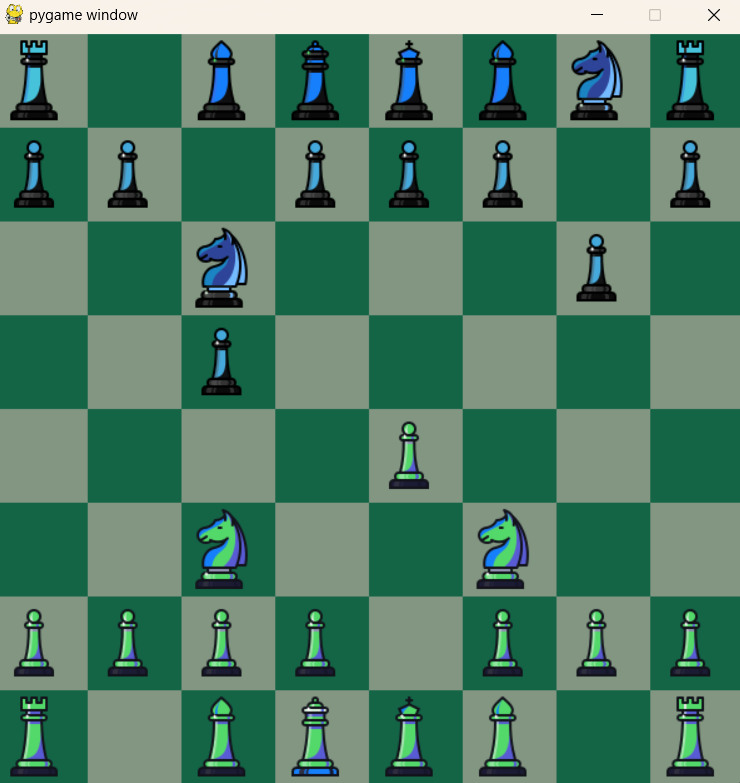

# Chess Engine

A chess game and engine in Python and Pygame, with human-vs-human and human-vs-AI modes. I wrote it in high school as a side project to learn search algorithms and game programming.



## How the engine works

- **Rules.** Legal move generation, including castling, promotion and checkmate detection.
- **Search.** Minimax with alpha-beta pruning to a depth of 4 plies.
- **Move ordering.** Captures, checks, threats and central moves are searched first, so alpha-beta prunes more of the tree.
- **Evaluation.** Material plus positional terms: pawn structure (isolated, doubled and passed pawns), piece development, knight centralization, bishops on the long diagonals, rooks on open files and castling.
- **Opening book.** A small hand-written book for the first moves.
- **Move cache.** Best moves found by the search are stored by position (FEN) in `best_moves.pickle` and reused in later games, so repeated positions are answered instantly.

## Running it

```bash
pip install pygame
python main.py
```

Click a piece and then its destination square to move.

## Code

- `main.py`: game loop, board drawing, move input and the AI (search and evaluation).
- `move_generator.py`: move generation and move ordering.
- `functions.py`: board helpers, castling and FEN conversion.
- `openings.py`: opening book.
- `settings.py`: window size, colors and frame rate.

## Ideas for later

Castling-rights tracking, quiescence search on captures, king safety in the evaluation, and iterative deepening with a time limit.
